# Git Config Sync

**Keep your Home Assistant folders and a git repo in sync, in both directions, with plain git.**

Git Config Sync is a Home Assistant OS app (add-on). Edit an automation in the Home Assistant UI and it shows up as a commit in your repo. Push a change from your laptop, or merge a pull request, and it lands on Home Assistant, which checks and reloads it. When both sides changed the same lines, it stops and lets you merge, like any git branch. It never silently overwrites either side.

An optional integration (installable from HACS) shows the sync state in Home Assistant and adds a **Sync now** button.

## What it does

- **Box → repo.** Whatever changes in the folders the app can see (from the UI, the file editor, other apps) is committed to a `box` branch and published to `main`.
- **Repo → box.** Whatever is pushed to `main` is applied to the box. If it touches Home Assistant's configuration, the app runs Home Assistant's config check, tells you the result, and reloads it.
- **Conflicts stop, they do not guess.** If the box and `main` changed the same lines, only `box` is pushed and you merge it into `main` like any branch. Git's merge options and `.gitattributes` can resolve some cases automatically if you want them to.
- **Every folder an app can see.** Home Assistant's configuration, other apps' configuration, `share`, `ssl`, `media`, `backup` and `local_apps`, or just one of them.
- **Any git host.** GitHub, GitLab, Gitea… over HTTPS with an access token.
- **A secret scanner** (gitleaks) warns about possible secrets in the repo, without ever printing them.

## How it works

The app is one more clone of your repo, living inside Home Assistant. It mounts the folders, treats them as git's work tree, and runs a sync cycle every few minutes (or when you press **Sync now**).



### The two branches

`main` is yours: you push to it, open pull requests against it, merge into it. `box` belongs to the app and always says what is on Home Assistant right now, even during a conflict. Each cycle commits the box's changes to `box`, merges `main` into it the way `git merge main` would, applies the result, and publishes it to both branches. The merge's first parent is `main`, so `git log --first-parent main` reads as your history.



*After the merge both branches point to the same commit: the box has your `scripts.yaml` and `main` has the automation edited in the UI.*

### One sync cycle



## The strategy

Syncing a live system with a repo is a merge problem, and git already solves merge problems very well. So instead of a custom sync engine, the app makes the box behave like **one more clone of the repo**:

- **The box is a clone.** The mounted folders are git's work tree; the repo is bare and lives in the app's private storage, so no `.git` ever appears in your folders.
- **Git does the work.** `git add -A` takes the snapshot, `git merge-tree` merges, `git read-tree -u` updates the files and refuses if something changed underneath. The app adds only what git does not do: the guards, Home Assistant's check and reload, the secret scanner, and telling you what happened.
- **The repo configures the app.** What is synced is the repo's own `.gitignore`; per-file merge rules are its `.gitattributes`; secret-scanner rules and ignores are its `.gitleaks.toml` and `.gitleaksignore`. The app's options only say how to reach the repo and how the box behaves.
- **Humans resolve what is ambiguous.** First syncs, conflicts and mass deletions push only `box` and wait for you to merge it into `main`. There is no "accept" button that decides for you.

## Design principles

- **You own your instance.** If you want `/ssl` in your private repo, that is your decision. Nothing is forbidden; the defaults (a base `.gitignore` committed on the first sync) only prevent accidents, and you can change them.
- **Standard behavior first.** Git's semantics, gitleaks' configuration, the standard `-X` merge options. Anything different would only be added as an option, if someone needs it.
- **Guards prevent accidents, they do not forbid choices.** Many deletions at once, files too large for a repo, paths that would land on the app's own folders: the sync stops and tells you; you decide.
- **Inform, never roll back.** If Home Assistant's config check reports errors, the change stays as it came from `main`, the reload is skipped, and you are told. You fix it in `main`.
- **Nothing silent.** Every state that needs you shows up in the app's panel, the integration's entities, an event and a notification.
- **Least privilege.** No long-lived Home Assistant token, no manager role; the access token can be limited to a single repo.

The full design, with every decision and why, is in [docs/design.md](docs/design.md).

## Install

**The app.** In Home Assistant: Settings → Apps → App store → ⋮ → Repositories, add `https://github.com/MaximilianoFelice/homeassistant-config-sync`, and install **Git Config Sync**. In its Configuration set:

- `repository`: your repo's HTTPS URL, e.g. `https://github.com/you/home.git`;
- `token`: an access token with read and write access to the repo's contents (on GitHub, a fine-grained token limited to that repo).

Start it. The first sync pushes only `box` and waits for you, even with an empty repo: with an empty repo you create `main` from `box`; with a repo that already has content, `box` goes on top of `main` and you merge it. Details in the [app documentation](homeassistant_config_sync/DOCS.md).

**The integration (optional).**

1. In HACS: ⋮ → Custom repositories, add the same URL as an *Integration*, and install **Git Config Sync**.
2. **Restart Home Assistant.** The app announces itself when it starts, but Home Assistant only picks that up for an integration it has loaded.
3. Settings → Devices & services → *Discovered*: **Git Config Sync** → **Add** → **Submit**. Nothing to type.

If it does not show up in *Discovered*, add it by hand (Add integration → Git Config Sync) with the host, port and API token from the app's web UI, section **Home Assistant integration**. It adds:

| Entity | What it shows |
|---|---|
| `sensor.git_config_sync_sync_state` | `idle`, `syncing`, `conflict`, `review`, `mass_delete`, `too_large`, `path_collision`, `blocked_secrets`, `check_failed`, `error` |
| `sensor.git_config_sync_last_sync` | When the last cycle finished |
| `sensor.git_config_sync_possible_secrets` | How many possible secrets the scanner sees (paths, rules and fingerprints as attributes, never values) |
| `binary_sensor.git_config_sync_needs_attention` | On when the state needs you |
| `binary_sensor.git_config_sync_restart_recommended` | On when an applied change needs a Home Assistant restart |
| `button.git_config_sync_sync_now` | Runs a cycle now (also from automations, with `button.press`) |

## What the repo looks like

With the default `root: /`, the repo mirrors the app's folders one to one:

```
.gitignore                     what is synced (git's rules)
.gitattributes                 optional: per-file merge rules
README.md                      your own files are kept and restored
homeassistant/
  configuration.yaml           = /homeassistant/configuration.yaml on the box
  automations.yaml
  packages/…
app_configs/
  a0d7b954_appdaemon/apps.yaml
share/…
```

With `root: /homeassistant` (or `config`) the repo holds only Home Assistant's configuration, without the prefix.

## Development

Tools are pinned in [mise.toml](mise.toml) (Go, golangci-lint, Node, Python, uv).

```bash
mise install
mise run check             # lint + Go tests with -race + build
mise run ui:build          # Lit web UI, embedded in the binary
mise run integration:test  # integration tests with the Home Assistant test harness
```

Heavier suites, in Docker and on synthetic fixtures:

```bash
mise run test:e2e          # E2E on testdata/ha-config (real check_config)
mise run test:ha-core      # HA client against a real Core
mise run supervisor:up     # real Supervisor with the local app
mise run test:supervisor   # install, options, startup and a full cycle inside the app
scripts/integration-e2e.sh # discovery → config flow → entities → Sync now
mise run supervisor:down
```

The diagrams are Mermaid sources in [docs/diagrams](docs/diagrams), rendered to `docs/img/*.svg` with `docs/diagrams/render.html` (HACS and Home Assistant do not render Mermaid).

CI runs on every push to `main`: lint, Go tests, E2E with the no-op checker, UI build and tests, integration tests, HACS validation and hassfest.

## Releases

A `vX.Y.Z` tag runs [the release workflow](.github/workflows/release.yml): the full test suite (including the Docker ones and the Supervisor test), multi-arch images (`amd64`, `aarch64`) on `ghcr.io/maximilianofelice/{arch}-homeassistant-config-sync`, and a GitHub release with the `hcs` binaries and checksums.

```bash
scripts/release.sh 0.1.1   # bumps the versions, checks the changelog, commits and tags
git push --follow-tags
```

## CLI

The engine is a single binary, `hcs`, which also runs outside Home Assistant:

```bash
hcs init     --config cfg.yaml --state-dir DIR   # bare repo, askpass program, API token
hcs plan     --config cfg.yaml --state-dir DIR   # what a sync would do, without writing anything
hcs sync     --config cfg.yaml --state-dir DIR   # one cycle
hcs serve    --config cfg.yaml --state-dir DIR   # HTTP API, web UI and scheduler
hcs status   --state-dir DIR
hcs scan-secrets DIR                             # gitleaks with DIR's .gitleaks.toml / .gitleaksignore
```

`--fs-root DIR` makes the root resolve under `DIR` instead of `/` (tests and local sandboxes).

## License

MIT.
